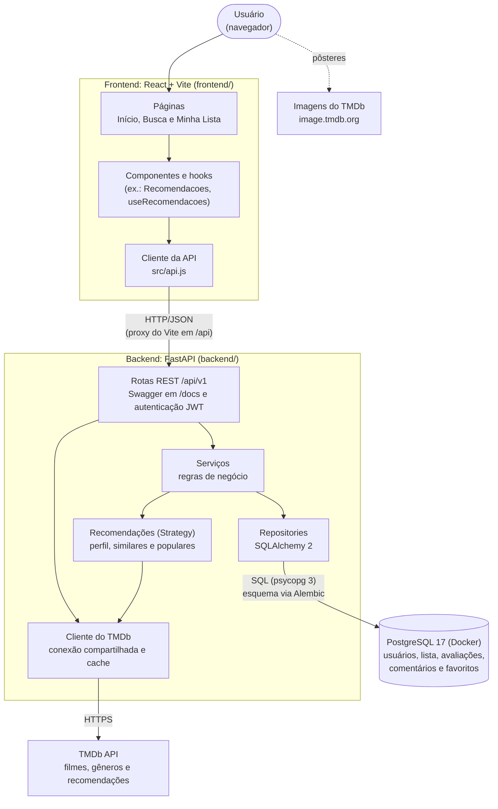
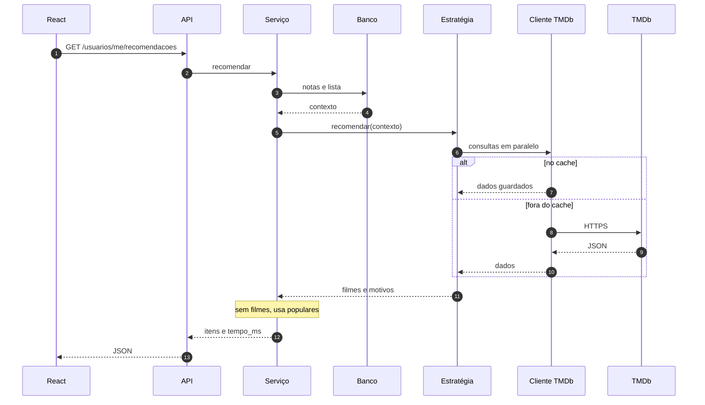

# Arquitetura

O frontend em React consome a API REST em Python (FastAPI). A API guarda os dados dos usuários no PostgreSQL e consulta o catálogo de filmes no TMDb. O token do TMDb fica só no backend; o navegador nunca o recebe.

## Visão geral

<!-- O README da raiz repete este diagrama: mantenha os dois iguais. -->

As rotas do catálogo (busca, listas e detalhes de filmes) consultam o TMDb diretamente. As rotas com dados do usuário passam pelos serviços e pelos Repositories até o banco. As recomendações usam os dois caminhos: os dados do usuário vêm do banco e os filmes, do TMDb.

O modelo de dados está no [DER](der.md).

## Camadas do backend

| Camada | Onde | Responsabilidade |
| --- | --- | --- |
| Rotas | [app/api/](../backend/app/api/) | Endpoints REST em `/api/v1`, validação de entrada e autenticação JWT. |
| Serviços | [app/services/](../backend/app/services/) | Regras de negócio: contas, lista, avaliações, comentários e recomendações. |
| Recomendações (Strategy) | [app/recomendacoes/](../backend/app/recomendacoes/) | Estratégias `perfil`, `similares` e `populares`, escolhidas em tempo de execução ([detalhes](../backend/README.md#recomendações-padrão-strategy)). |
| Repositories | [app/repositories/](../backend/app/repositories/) | Consultas ao banco com SQLAlchemy 2. |
| Modelos e migrações | [app/models/](../backend/app/models/) e [migrations/](../backend/migrations/) | Tabelas mapeadas no ORM e evolução do esquema com Alembic. |
| Cliente do TMDb | [tmdb_service.py](../backend/app/services/tmdb_service.py) e [cache_tmdb.py](../backend/app/services/cache_tmdb.py) | Conexão compartilhada com o TMDb e cache em memória das respostas. |
| Núcleo | [app/core/](../backend/app/core/) | Configuração (`.env`), segurança (JWT e hash Argon2) e erros de negócio. |

## Fluxo de uma recomendação

1. O React chama `GET /api/v1/usuarios/me/recomendacoes?estrategia=perfil&limite=10` com o token JWT.
2. A rota valida o token e os parâmetros e chama o `RecomendacaoService`.
3. O serviço busca no banco, pelos Repositories, as notas, os comentários e a lista do usuário, e monta o contexto: notas e filmes a excluir.
4. A estratégia escolhida (padrão Strategy) faz as consultas ao TMDb em paralelo pelo cliente compartilhado. Respostas recentes vêm do cache, sem nova consulta.
5. Se a estratégia não encontrar filmes, o serviço usa a estratégia `populares`.
6. A resposta traz a estratégia usada, os filmes com o motivo de cada um e o `tempo_ms`, que a tela inicial mostra abaixo das recomendações.

## Componentes

| Componente | Tecnologia | Endereço em desenvolvimento | Pasta |
| --- | --- | --- | --- |
| Frontend | React 19 e Vite | `http://localhost:5173` | [frontend/](../frontend/) |
| Backend | Python 3.12, FastAPI, SQLAlchemy 2, Alembic e uv | `http://localhost:8000` (Swagger em `/docs`) | [backend/](../backend/README.md) |
| Banco de dados | PostgreSQL 17 com Docker Compose | `localhost:5432` | [infra/](../infra/README.md) |
| API externa | TMDb | `https://api.themoviedb.org` | — |

Em desenvolvimento, o Vite repassa as chamadas de `/api` para o backend (`frontend/vite.config.js`). Assim, o navegador fala só com o Vite.
