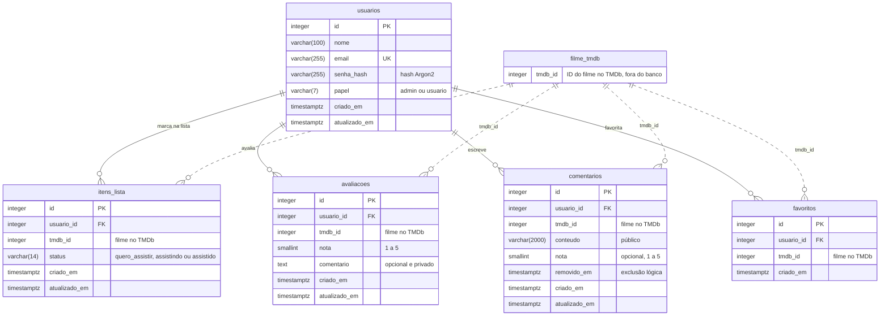

# Modelo de dados (DER)

O banco PostgreSQL guarda as contas e o estado pessoal de cada usuário: lista, avaliações, comentários e favoritos. Os dados dos filmes (título, gêneros, imagens, elenco) vêm do TMDb em tempo real e são referenciados pela coluna `tmdb_id`, sem tabela local.

O diagrama corresponde às migrações do Alembic até a revisão `b2e5d0a3f8c7` ([backend/migrations/versions/](../backend/migrations/versions/)) e aos modelos em [backend/app/models/](../backend/app/models/). Ele foi conferido com o esquema de um banco migrado em 2026-11-24.

## Diagrama



As linhas contínuas são chaves estrangeiras. As tracejadas ligam cada registro ao filme no TMDb pelo `tmdb_id`, sem chave estrangeira, porque o filme não fica no banco. Por isso `filme_tmdb` não é uma tabela.

## Tabelas

| Tabela | O que guarda | Restrições |
| --- | --- | --- |
| `usuarios` | Contas: nome, e-mail, senha (hash Argon2) e papel. | E-mail único. Papel `admin` ou `usuario`. |
| `itens_lista` | Situação de cada filme na lista do usuário (RF1). | Um registro por usuário e filme. Status `quero_assistir`, `assistindo` ou `assistido`. |
| `avaliacoes` | Nota pessoal e comentário privado opcional (RF2). | Uma avaliação por usuário e filme. Nota de 1 a 5. |
| `comentarios` | Comentários públicos dos filmes, com nota opcional (RF2). | Conteúdo não vazio, com até 2000 caracteres. Nota de 1 a 5 ou vazia. |
| `favoritos` | Filmes favoritados pelo usuário. | Um registro por usuário e filme. |

A tabela `alembic_version` pertence ao Alembic (controle das migrações) e não faz parte do diagrama.

## Regras de integridade

- Todas as tabelas têm chave primária `id` (inteiro sequencial).
- `usuario_id` referencia `usuarios.id` com `ON DELETE CASCADE`: ao excluir uma conta, a lista, as avaliações, os comentários e os favoritos dela também são excluídos.
- `tmdb_id` é obrigatório e sempre positivo.
- A unicidade por usuário e filme vale para `itens_lista`, `avaliacoes` e `favoritos` (restrições `uq_*_usuario_tmdb`).
- Em `comentarios`, o mesmo usuário pode comentar um filme mais de uma vez. A aplicação usa o comentário mais recente não removido. Remover um comentário preenche `removido_em`, sem apagar a linha.
- A nota pessoal exibida e usada nas recomendações é a do comentário mais recente, quando ele tem nota. Caso contrário, vale a da avaliação.

## Índices

| Índice | Colunas |
| --- | --- |
| `uq_usuarios_email` (único) | `usuarios(email)` |
| `uq_itens_lista_usuario_tmdb` (único) | `itens_lista(usuario_id, tmdb_id)` |
| `ix_itens_lista_usuario_status` | `itens_lista(usuario_id, status)` |
| `ix_itens_lista_tmdb_id` | `itens_lista(tmdb_id)` |
| `uq_avaliacoes_usuario_tmdb` (único) | `avaliacoes(usuario_id, tmdb_id)` |
| `ix_avaliacoes_tmdb_id` | `avaliacoes(tmdb_id)` |
| `ix_comentarios_tmdb_criado` | `comentarios(tmdb_id, criado_em)` |
| `uq_favoritos_usuario_tmdb` (único) | `favoritos(usuario_id, tmdb_id)` |
| `ix_favoritos_tmdb_id` | `favoritos(tmdb_id)` |

## Normalização (RNF1)

- Cada tabela trata de um único assunto, e seus atributos dependem apenas da chave primária.
- Os dados dos filmes não são copiados para o banco: ficam no TMDb e são referenciados por `tmdb_id`, o que evita dados duplicados ou desatualizados.

## Como conferir no banco local

Com o banco rodando (veja [infra/](../infra/README.md)), liste as tabelas e a estrutura de cada uma com os valores padrão do Docker Compose:

```bash
docker exec catalogo-postgres psql -U catalogo -d catalogo -c "\dt"
docker exec catalogo-postgres psql -U catalogo -d catalogo -c "\d itens_lista"
```
